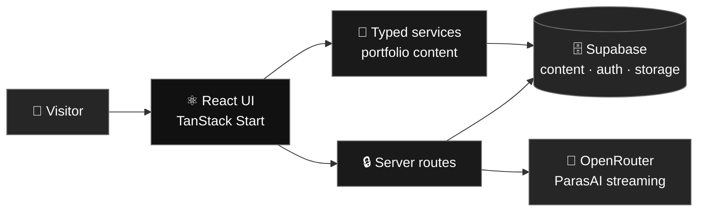
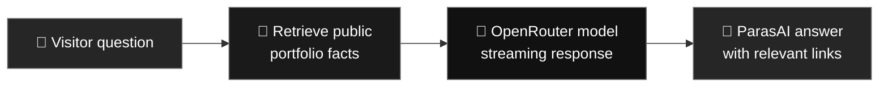

<!-- ═══════════════════════ HEADER ═══════════════════════ -->
<div align="center">


<br/>


<a href="https://github.com/paraskosambe-web/paras-kosambe-portfolio-website/commits/main"></a>

<br/><br/>

<a href="#overview"></a>
<a href="#features"></a>
<a href="#architecture"></a>
<a href="#tech-stack"></a>
<a href="#getting-started"></a>
<a href="#parasai"></a>

</div>

<br/>

<!-- ═══════════════════════ OVERVIEW ═══════════════════════ -->
## 🌐 Overview

**Paras Kosambe Portfolio** is a responsive, full-stack personal portfolio for presenting Paras’s projects, skills, experience, certifications, achievements, and artwork. Public content is served through typed service functions and can be managed through a standalone admin area.

> 💡 **In one line:** Explore Paras’s work, learn about his background, get in touch, or ask **ParasAI** about general topics and the portfolio.

<div align="center">

| 👀 **For visitors** | 🛠️ **For the portfolio owner** |
|:---|:---|
| Explore projects and detailed case studies | Edit portfolio content in the admin area |
| Browse skills, experience, certifications, and achievements | Manage projects, artwork, resume, and site information |
| View the art collection and resume | Review contact form submissions |
| Contact Paras through the contact page | Keep content backed by Supabase |
| Ask ParasAI general or portfolio questions | |

</div>

<!-- ═══════════════════════ FEATURES ═══════════════════════ -->
<a id="features"></a>

## ✨ Features

<table>
<tr>
<td width="50%" valign="top">

### 🧭 Portfolio pages
Individual pages cover the main areas of Paras’s work and background.
- Home overview and About page
- Projects collection and project details
- Skills, experience, certifications, and achievements
- Art gallery, resume, and contact page

</td>
<td width="50%" valign="top">

### 🗂️ Consistent content system
Portfolio copy is read through typed service functions, with mock content available when the database is not connected. Collection pages share a common card component for a consistent browsing experience.

</td>
</tr>
<tr>
<td width="50%" valign="top">

### 🤖 ParasAI
An AI assistant for general questions and portfolio-aware answers, with streaming responses, conversation context, browser-saved history, Markdown, code blocks, copy and regenerate actions, stop generation, and text/code file attachments.

</td>
<td width="50%" valign="top">

### 🔐 Admin area
A standalone sign-in and management experience for editing portfolio content and reviewing contact submissions, outside the public navigation shell.

</td>
</tr>
<tr>
<td width="50%" valign="top">

### 📱 Responsive design
An editorial, monochrome interface that adapts across desktop and mobile screens, with motion that respects reduced-motion preferences.

</td>
<td width="50%" valign="top">

### ☁️ Managed content and media
Supabase provides public portfolio data, authentication, contact submissions, and media storage. The server exposes public media through a controlled route.

</td>
</tr>
</table>

### 🗺️ Main routes

| Route | Page |
|:---|:---|
| `/` | Home |
| `/about` | About Paras |
| `/projects` | Project collection |
| `/projects/:slug` | Project details |
| `/skills` | Skills |
| `/experience` | Experience |
| `/certifications` | Certifications |
| `/achievements` | Achievements |
| `/art` | Art collection |
| `/resume` | Resume |
| `/contact` | Contact |
| `/admin` | Admin sign-in and content management |

<!-- ═══════════════════════ ARCHITECTURE ═══════════════════════ -->
<a id="architecture"></a>

## 🏗️ Architecture

TanStack Start handles file-based routes, server rendering, and server endpoints. Typed service functions provide portfolio data to the interface. Supabase stores managed content, while ParasAI calls OpenRouter from the server so its API key stays private.



<!-- ═══════════════════════ TECH STACK ═══════════════════════ -->
<a id="tech-stack"></a>

## 🛠️ Tech Stack

| Area | Technologies |
|:---|:---|
| UI | React 19, TypeScript, Tailwind CSS 4 |
| App framework and routes | TanStack Start, TanStack Router, Vite |
| Motion and components | Motion, Lucide, Radix UI, shadcn-style components |
| Forms and validation | React Hook Form, Zod |
| Data and auth | Supabase, TanStack Query |
| AI | OpenRouter-compatible chat completions API |
| Deployment | Vercel |

<!-- ═══════════════════════ PARASAI ═══════════════════════ -->
<a id="parasai"></a>

## 🤖 ParasAI

ParasAI combines general-purpose assistance with answers grounded in public portfolio information. Portfolio facts are retrieved server-side from the current public content before being sent to the model. The model API key is used only on the server.



Chat history is stored in the visitor’s browser. Text and code attachments are sent as conversation context; each file is limited to 200 KB and supported text is capped before sending. The current attachment flow does not process PDFs or images.

<!-- ═══════════════════════ GETTING STARTED ═══════════════════════ -->
<a id="getting-started"></a>

## 🚀 Getting Started

### Requirements

- Node.js and npm
- A Supabase project for managed portfolio content and admin features
- An OpenRouter API key to enable ParasAI responses

### 1. Clone and install

```bash
git clone https://github.com/paraskosambe-web/paras-kosambe-portfolio-website.git
cd paras-kosambe-portfolio-website
npm install
```

### 2. Configure environment variables

Create a `.env` file in the project root. Add the values from your Supabase and OpenRouter projects:

```env
# Supabase browser configuration (publishable key only)
VITE_SUPABASE_URL=
VITE_SUPABASE_PUBLISHABLE_KEY=

# Supabase server configuration
SUPABASE_URL=
SUPABASE_PUBLISHABLE_KEY=
SUPABASE_SERVICE_ROLE_KEY=

# ParasAI server configuration
OPENROUTER_API_KEY=
OPENROUTER_MODEL=openrouter/auto
```

`SUPABASE_SERVICE_ROLE_KEY` and `OPENROUTER_API_KEY` are secrets. Keep them server-side and never use a `VITE_` prefix for secret values. Do not commit `.env`; it is ignored by Git.

### 3. Set up the database

Apply the SQL migrations in `supabase/migrations` to your Supabase project. Configure Supabase Auth and the required storage buckets for the admin and media features. Keep row-level security policies enabled for exposed tables.

### 4. Start the development server

```bash
npm run dev
```

Open the local URL printed by Vite.

### Available scripts

| Command | Purpose |
|:---|:---|
| `npm run dev` | Start the local development server |
| `npm run build` | Build the production app |
| `npm run preview` | Preview a production build locally |
| `npm run lint` | Run ESLint |
| `npm run format` | Format project files with Prettier |

<!-- ═══════════════════════ PROJECT STRUCTURE ═══════════════════════ -->
## 📂 Project Structure

```text
src/
├── components/       # Page, layout, portfolio, and admin UI
├── config/           # Site configuration
├── data/             # Mock portfolio content
├── integrations/     # Supabase clients, auth, and generated types
├── routes/           # TanStack file-based routes and API endpoints
├── services/         # Typed content, portfolio, and ParasAI services
├── types/            # Shared site types
├── styles.css        # Global styles
├── router.tsx        # Router setup
└── server.ts         # Server entry and error handling
supabase/
└── migrations/       # Database migrations
public/               # Public assets and resume
```

<!-- ═══════════════════════ DEPLOYMENT ═══════════════════════ -->
## 🚀 Deployment

The repository is configured for Vercel with TanStack Start. Add the required environment variables in the Vercel project settings, then deploy the connected repository. Set `OPENROUTER_MODEL` only if you want a model other than `openrouter/auto`.

## 🔗 Links

- **Live portfolio:** [paras-kosambe.lovable.app](https://paras-kosambe.lovable.app)
- **GitHub:** [paraskosambe-web](https://github.com/paraskosambe-web)
- **LinkedIn:** [Paras Kosambe](https://www.linkedin.com/in/paras-kosambe)
- **Lovable project:** [Open in Lovable](https://lovable.dev/projects/e41028ad-5804-4c23-bd80-223946e943a0)

---

<div align="center">

**Designed and built by [Paras Kosambe](https://github.com/paraskosambe-web).**

Built with [Lovable](https://lovable.dev), React, TanStack Start, TypeScript, and Supabase.

</div>
